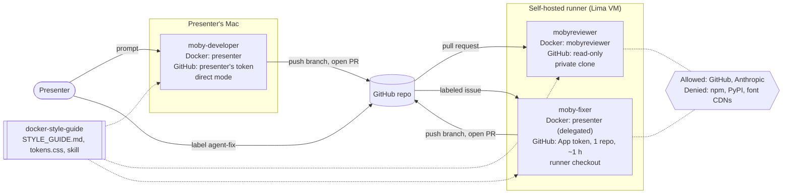
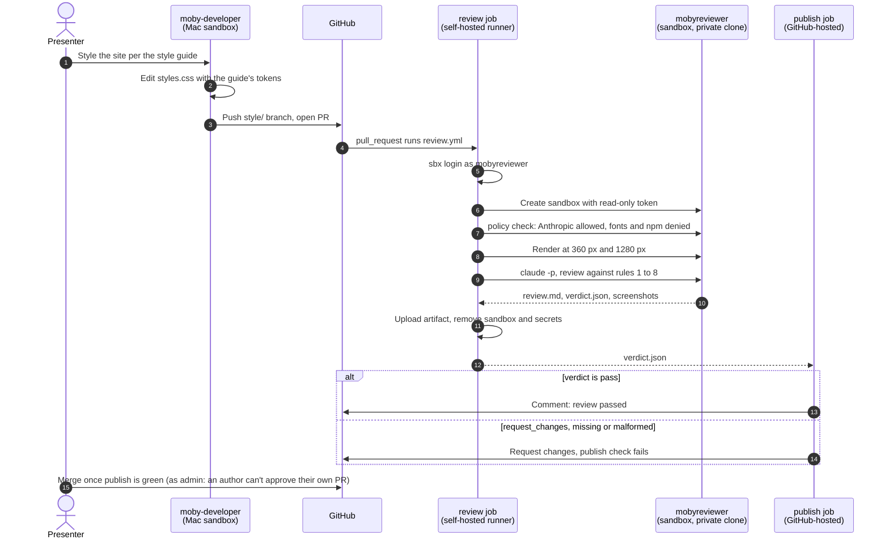
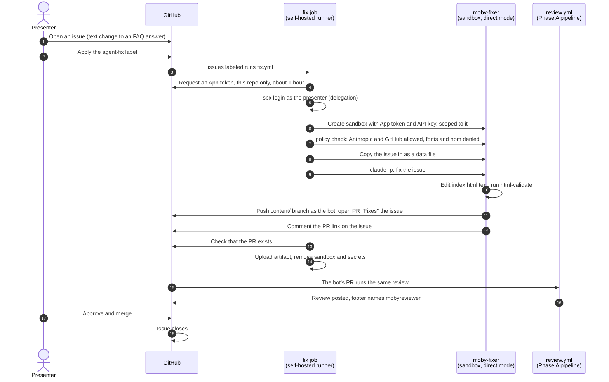
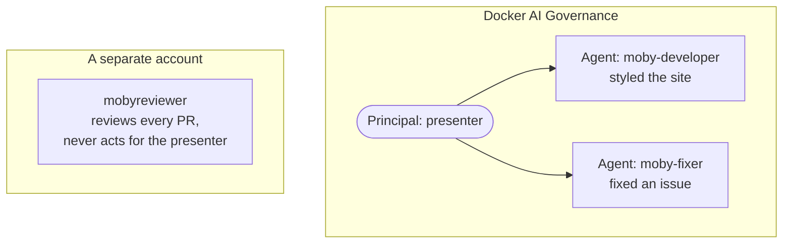

# Moby FAQ: agents acting on behalf of people

This repo is a small static FAQ page and the pipeline around it. It's the target of a live demo of [Docker Sandboxes](https://docs.docker.com/ai/sandboxes/) (`sbx`): one coding agent (Claude Code) and one style guide, used in three roles. Each role has its own identity, its own credentials and its own network limits ("blast radius"), and every run is recorded against the person or account it acts for.

- **Phase A:** a developer agent styles the site, and a reviewer agent checks the PR against the style guide in CI.
- **Phase B:** a fixer agent picks up an issue, makes the change and opens a PR, working on behalf of the person who approved it.

## The three roles

| | Developer | Reviewer | Fixer (Phase B) |
|---|---|---|---|
| Kit | `moby-developer` | `mobyreviewer` | `moby-fixer` |
| Runs | on the presenter's Mac | in GitHub Actions, on a self-hosted runner | in GitHub Actions, on the same runner |
| Started by | the presenter, by prompt | a pull request | a person applying the `agent-fix` label to an issue |
| Docker identity | the presenter | `mobyreviewer`, an org-managed account | the presenter (delegation) |
| GitHub access | the presenter's token, scoped to this one sandbox | read-only; a separate job posts the review | a GitHub App token for this repo only, which expires in about an hour |
| Workspace | the presenter's checkout | a private clone it can't push from | the runner's checkout, so it can push a branch |
| Network | GitHub and Anthropic | GitHub and Anthropic; package registries and font CDNs denied | GitHub and Anthropic; package registries and font CDNs denied |

All three compose the same `docker-style-guide` kit. It ships [`STYLE_GUIDE.md`](STYLE_GUIDE.md), [`tokens.css`](tokens.css) and a skill that tells the agent how to apply and check the guide. The same version string appears on every review.

## What the demo shows

1. **One agent, different identities.** The same Claude Code runs as the developer, as the reviewer and as the fixer. What changes is who it acts for and what it holds, and that is set by the sandbox, not by the prompt.
2. **The blast radius is proved before the agent runs.** Each CI job runs `sbx policy check` first: Anthropic and GitHub must be allowed, and a font CDN and the npm registry must be denied. If they aren't, the job stops.
3. **The reviewer never holds a write token.** The `review` job has `contents: read`. A separate `publish` job reads the agent's `verdict.json` and posts the review. A missing or malformed verdict counts as "request changes" (it fails closed).
4. **A style guide that can be enforced.** Rules 1–7 are checkable (color and type tokens, no web fonts, the spacing scale, a single column, focus states, contrast, no inline styles) and can block a merge. Rule 8 (tone) can only be a suggestion. The reviewer renders the page at mobile and desktop widths, and the screenshots are in the run's artifact.
5. **Delegation you can audit.** The fixer signs in to Docker as the presenter, so Docker's AI Governance view shows one principal with two agents, `moby-developer` and `moby-fixer`. GitHub writes still go through a bot with a narrow, short-lived token.
6. **People stay in the loop, and there are no agent loops.** Only a person applying a label starts the fixer; issue text can't. The fixer's PR goes through the same review as everyone else's, and a person approves and merges it. Reviews never start the fixer.
7. **Issue text is data, not instructions.** The issue is handed to the fixer as a file, and its instructions say to treat it as a change request. A prompt-injection attempt in an issue only produces a text change.

## How it works

### Who acts for whom

Each agent runs in its own sandbox. The sandbox decides the Docker identity it's recorded under, the GitHub credential the proxy injects for it, and the hosts it can reach. The agent never sees a raw token.

### Phase A: style the site, review the PR

### Phase B: a person labels an issue, the fixer opens a PR

### What AI Governance records

Every sandbox run is recorded against the Docker account it signed in as. The fixer signs in as the presenter, so the presenter is the principal for two agents. The reviewer signs in as its own account, `mobyreviewer`, so it never acts for the presenter. On GitHub, the fixer's commits and PR show as the App's bot, not as the presenter.

## What's in the repo

| Path | What it is |
|---|---|
| `index.html`, `styles.css`, `tokens.css` | the site. Static, with no build step, dependencies or web fonts. |
| `STYLE_GUIDE.md` | the style guide (a copy of the kit's) |
| `kits/docker-style-guide/` | the mixin: style guide, tokens and skill |
| `kits/moby-developer/`, `kits/mobyreviewer/`, `kits/moby-fixer/` | the three agent kits: an image, a network policy, credential rules and the agent's instructions |
| `.github/workflows/review.yml`, `.github/scripts/gate.sh` | the review pipeline: `review` → `publish` → `build` |
| `.github/workflows/fix.yml` | the fixer, started by the `agent-fix` label |
| `presenter/` | tooling for running the demo (below) |

The kit sources are here so you can read them. CI pulls the published images from Docker Hub.

## Running the demo

Each run uses a new, disposable copy of this repo, which is deleted afterwards. Start with the presenter docs:

- **[presenter/DEMO_STEPS.md](presenter/DEMO_STEPS.md):** one-time setup (runner VM, GitHub App, images, environment file), then each run step by step. It covers setup, the Phase A and Phase B beats with talking points, teardown, rehearsal checks, troubleshooting and fallbacks.
- [`presenter/setup-demo-repo.sh`](presenter/setup-demo-repo.sh): creates the demo repo, its variables, secrets and branch protection, moves the self-hosted runner to it and, for Phase B, configures the fixer. Run it with `--help` for the options, and with `--dry-run` first.
- [`presenter/teardown-demo-repo.sh`](presenter/teardown-demo-repo.sh): removes the developer sandbox and its secrets, deletes the demo repo and its local clone.
- [`presenter/local-review.sh`](presenter/local-review.sh): runs the review on your machine without GitHub Actions, as a fallback.

To run Phase A only, use the [`phase-a-v1.0.0`](https://github.com/jeremyrdavis/faq-site/releases/tag/phase-a-v1.0.0) release.
